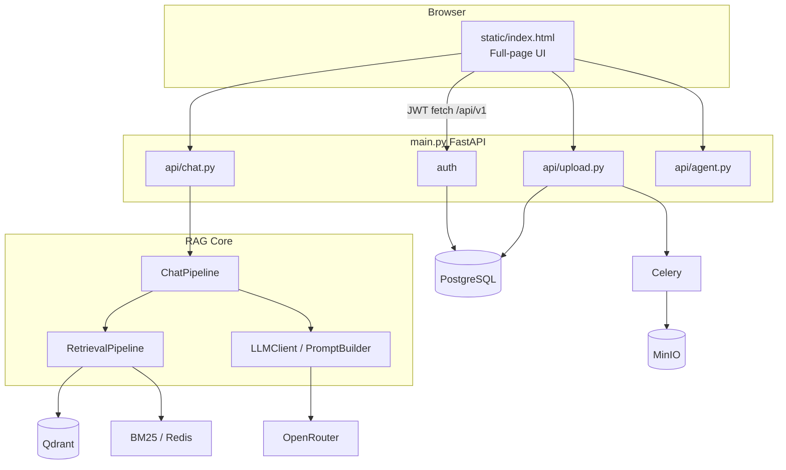
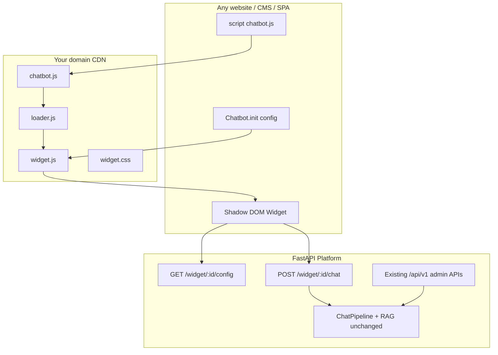

# Enterprise Multimodal RAG — Full Architecture Review
## Path to a Universal Embeddable Chatbot SDK

**Project root:** `MULTI-MODEL-RAG-CHATBOT-Especially-on-Pdf-Docx-PPt-Excel--main/`  
**Stack:** FastAPI · PostgreSQL · Redis · Qdrant · MinIO · Celery · OpenRouter · sentence-transformers  
**UI today:** Single-page app at `/` (`static/index.html`) — **not** embeddable  
**Goal:** `<script src="…/chatbot.js"></script>` + `window.Chatbot.init({…})` on any website

**Verdict:** This project is a **full multi-tenant RAG backend + admin web UI**, not an embeddable widget. The RAG/API layers are largely reusable; the UI (`static/index.html`) is a monolithic same-origin app and must be replaced with an SDK (`chatbot.js` + Shadow DOM widget).

---

## 1. Complete Folder Structure

```
MULTI-MODEL-RAG-CHATBOT-Especially-on-Pdf-Docx-PPt-Excel--main/
├── main.py                    # FastAPI entry: routers, CORS, static UI, startup
├── requirements.txt           # Python dependencies
├── docker-compose.yml         # Qdrant, Postgres, Redis, MinIO, Celery, monitoring
├── Dockerfile                 # App/worker image
├── alembic.ini + alembic/     # DB migrations
├── README.md                  # Existing ops/docs README
├── static/
│   └── index.html             # FULL chatbot UI (HTML+CSS+JS monolithic) ★
├── scripts/
│   ├── run_worker.bat|.sh     # Celery worker launchers
├── deploy/
│   ├── prometheus/            # Metrics scrape config
│   └── grafana/               # Datasource provisioning
├── data/raw/                  # Uploaded files (local fallback / MinIO mirror)
├── logs/app.log               # Runtime logs (ignore for architecture)
├── tests/                     # Phase 3/4, tenant isolation, API key tests
└── app/
    ├── config.py              # Pydantic Settings (.env)
    ├── celery_app.py          # Celery app
    ├── api/                   # REST routers ★
    ├── auth/                  # JWT + API key deps
    ├── db/                    # SQLAlchemy models + session
    ├── cache/                 # Redis
    ├── storage/               # MinIO / local disk
    ├── services/              # Documents, quotas, audit, API keys
    ├── workflows/             # Ingest, index, retrieve, chat pipelines ★
    ├── ingestion/             # File loaders/parsers
    ├── document_structure/    # Headings, sections, captions
    ├── chunking/              # Semantic / section / parent-child / multimodal
    ├── embeddings/            # Text (BGE), image (CLIP), table
    ├── vectorstore/           # Qdrant collections + indexing
    ├── retrieval/             # BM25, dense, hybrid, tenant filter, boost
    ├── reranking/             # BGE cross-encoder
    ├── context_builder/       # Assemble context + token budget
    ├── llm/                   # Prompts, OpenRouter, citations, hallucination ★
    ├── agents/                # LangChain agent + Redis memory
    ├── models/                # Pydantic request/response models
    ├── tasks/                 # Celery document processing
    ├── monitoring/            # Prometheus
    └── utils/                 # Logger, file/text helpers
```

### Important folders

| Folder | Role |
|--------|------|
| `app/api/` | HTTP surface: auth, upload, chat, search, documents, agent, tenants, keys |
| `app/workflows/` | Orchestrates RAG end-to-end |
| `app/llm/` | Prompt templates + OpenRouter + citations |
| `app/retrieval/` + `vectorstore/` + `embeddings/` | Core RAG engine |
| `app/db/` | Tenants, users, documents, API keys, usage (Postgres) |
| `static/` | **Only** frontend today — tightly coupled admin+chat UI |
| `docker-compose.yml` | Infra: Qdrant :6333, Postgres :5433, Redis :6379, MinIO :9000/:9001 |

### Important files (chatbot path)

| File | Why it matters |
|------|----------------|
| `main.py` | Mounts routers; serves UI at `/`; CORS `allow_origins=["*"]` |
| `static/index.html` | Login, upload, document list, chat, agent toggle — all in one file |
| `app/api/chat.py` | `POST /api/v1/chat` (+ stub stream) |
| `app/workflows/chat_pipeline.py` | Retrieve → generate → cite → confidence |
| `app/workflows/retrieval_pipeline.py` | Hybrid search, boost, rerank, context |
| `app/llm/prompt_builder.py` | System + RAG/chat prompts |
| `app/llm/llm_client.py` | OpenRouter chat completions |
| `app/auth/dependencies.py` | JWT Bearer **or** `X-API-Key` |
| `app/config.py` | Typed settings from `.env` |

---

## 2. Overall Architecture

### Frontend (today)
- **Not a widget.** Full-page dark UI in `static/index.html`.
- Inline CSS (`:root` design tokens) + inline JS.
- Auth: register/login → JWT in `localStorage` (`rag_access_token`).
- Chat: `fetch("/api/v1/chat")` or `/api/v1/agent/chat`.
- History: **in-memory** `conversationHistory[]` (not server DB).
- Agent session ID: `localStorage` (`rag_agent_session`).

### Backend
- FastAPI app (`main.py`), version ~1.4.0.
- Multi-tenant SaaS: tenants, users, plans (free/pro/enterprise), quotas, audit.
- Async document ingest via Celery + MinIO (or local disk).

### RAG Pipeline
1. **Ingest** (`ingestion_pipeline`) — parse PDF/DOCX/PPTX/Excel/images  
2. **Index** (`indexing_pipeline`) — chunk → embed → Qdrant + BM25  
3. **Retrieve** (`retrieval_pipeline`) — hybrid + boost + optional BGE rerank  
4. **Generate** (`chat_pipeline` + `llm/`) — prompt + OpenRouter + citations  

### API Layer
- Prefix `/api/v1/*`
- Auth via `Depends(get_current_user)` unless `REQUIRE_AUTH=false`
- Public: health, auth register/login
- Protected: upload, chat, search, documents, agent, tenants, keys, usage, audit

### Database (PostgreSQL)
- `tenants`, `users`, `documents`, `api_keys`, `tenant_usage`, audit tables  
- Document metadata + processing status; **not** vector storage

### Vector Database (Qdrant)
Collections (`app/vectorstore/collections.py`):
- `text_chunks`, `table_chunks`, `image_chunks`, `multimodal_chunks`  
- Tenant isolation via payload filters (`tenant_id`)

### Embedding Model
- Text: `TEXT_EMBEDDING_MODEL` (default `BAAI/bge-m3`; README also mentions `bge-small-en-v1.5`)
- Images: CLIP (`clip-ViT-B-32`)
- Device: `EMBEDDING_DEVICE` (cpu/cuda)

### LLM Provider
- **OpenRouter** (`OPENROUTER_API_KEY`, `OPENROUTER_BASE_URL`)
- Default model: `anthropic/claude-3-haiku:beta`
- Client: `httpx` → `/chat/completions`

### Prompt Templates
- Defined in `app/llm/prompt_builder.py` (hardcoded Python strings)
- System prompt: answer only from context, cite, don’t invent
- Variants: RAG, chat-with-history, multimodal, summarization, hallucination check

### Retrieval Flow
Query → normalize → dense and/or BM25 → tenant/doc filter → query boost / section heuristics → optional rerank → context assemble (token budget) → citations list

### Response Generation Flow
Context + query → `PromptBuilder` → `LLMClient` → answer → `CitationBuilder` → optional hallucination check → confidence score → `ChatResponse` JSON

---

## 3. Complete Execution Flow (Today)

```
User opens http://localhost:8000
        ↓
main.py GET / → FileResponse(static/index.html)
        ↓
Frontend init (inline <script>)
  - If localStorage has JWT → setAuth() → show app
  - Else show login/register card
        ↓
User registers/logs in → POST /api/v1/auth/register|login
  - JWT stored; documents refreshed
        ↓
(Optional) Upload → POST /api/v1/upload (multipart)
  - MinIO/local save → Celery process_document
  - Poll GET /api/v1/upload/status/{id}
        ↓
User sends message → sendChat()
  - POST /api/v1/chat  OR  /api/v1/agent/chat
  - Headers: Authorization: Bearer <jwt>
  - Body: { query, document_id?, conversation_history?, use_reranking }
        ↓
Backend: app/api/chat.py
  - Auth → quota check → tenant document scope
  - ChatPipeline.chat(...)
        ↓
RAG: RetrievalPipeline.retrieve(...)
  - Embed query (dense) + BM25
  - Hybrid merge, boost, filter, rerank
  - ContextAssembler builds context string
        ↓
Prompt: PromptBuilder.build_rag_prompt | build_chat_prompt
        ↓
LLM: LLMClient → OpenRouter chat/completions
        ↓
Post-process: citations + hallucination + confidence
        ↓
HTTP JSON ChatResponse
        ↓
Frontend: addMessage("assistant", data.answer)
  - Push to conversationHistory
  - Show model / confidence / latency in meta
```

**Critical gap vs your goal:** There is no floating widget, no `chatbot.js`, no `chatbotId`, no third-party embed path. The host page **is** the product UI.

---

## 4. Chatbot File Analysis

| File | Purpose | Called by | Depends on it | Reusable? | Refactor? |
|------|---------|-----------|---------------|-----------|-----------|
| `static/index.html` | Entire UI | Browser via `/` | Nothing (leaf) | **No** as widget | **Replace** with SDK |
| `app/api/chat.py` | Chat HTTP API | Frontend / clients | `ChatPipeline`, auth, usage | **Yes** | Add public widget endpoint / chatbotId |
| `app/api/agent.py` | Agentic chat | UI agent toggle | `AgentService` | Optional for SDK | Keep admin-only or feature flag |
| `app/workflows/chat_pipeline.py` | RAG orchestration | chat API | retrieval + llm | **Yes** | Minor: config injection |
| `app/workflows/retrieval_pipeline.py` | Search orchestration | chat pipeline | retrieval/* | **Yes** | Keep |
| `app/llm/*` | Prompt + LLM + cites | chat pipeline | OpenRouter | **Yes** | Externalize prompts per chatbot |
| `app/api/upload.py` | Ingest | Admin UI | pipelines, Celery | Admin SDK only | Not for public widget |
| `app/api/documents.py` | List/delete docs | Admin UI | document_service | Admin | Keep |
| `app/api/auth.py` | Register/login | Admin UI | JWT | Admin | Widget should use API key / public token |
| `app/auth/dependencies.py` | Auth gate | All protected APIs | JWT + ApiKey | **Yes** | Add `chatbotId` resolution |
| `app/services/api_key_service.py` | Tenant API keys | Auth | DB | **Yes** — ideal for embed | Map key → tenant/chatbot |
| `main.py` | App bootstrap | uvicorn | all routers | Keep | Mount `/sdk/chatbot.js` CDN assets |

---

## 5. API Analysis

### Chat-related endpoints

| Method | Path | Auth | Request | Response |
|--------|------|------|---------|----------|
| `POST` | `/api/v1/chat` | JWT or `X-API-Key` | `{ query, document_id?, conversation_history?, use_reranking, top_k? }` | `ChatResponse`: answer, citations, sources, confidence, timing, model, context_used |
| `POST` | `/api/v1/chat/stream` | Yes | same | **Placeholder** — not implemented |
| `POST` | `/api/v1/agent/chat` | Yes | `{ query, document_id?, session_id?, use_memory }` | answer, tools_used, session_id, … |
| `POST` | `/api/v1/agent/session` | Yes | — | `{ session_id }` |
| `DELETE` | `/api/v1/agent/session/{id}` | Yes | — | clear Redis memory |

### Supporting APIs (admin / ingest)

| Method | Path | Notes |
|--------|------|-------|
| `POST` | `/api/v1/auth/register` | Creates tenant + admin |
| `POST` | `/api/v1/auth/login` | OAuth2 form → JWT |
| `POST` | `/api/v1/upload` | Multipart file; async processing |
| `GET` | `/api/v1/upload/status/{id}` | Progress polling |
| `GET/DELETE` | `/api/v1/documents` | Tenant docs |
| `POST` | `/api/v1/search` | Retrieval without LLM |
| `POST` | `/api/v1/api-keys` | Admin creates key (shown once) |
| `GET` | `/api/v1/health` | Public health |

### Auth
- `Authorization: Bearer <jwt>` **or** `X-API-Key: <key>`
- `REQUIRE_AUTH=false` → synthetic/dev user
- Roles: admin vs member; admin for keys/tenant patch

### Middleware
- CORSMiddleware: origins `*`, credentials true, all methods/headers
- Prometheus instrumentation (`/metrics`)
- No dedicated rate-limit middleware beyond plan quotas in services

### Error handling
- FastAPI `HTTPException` (401/403/500)
- Chat wraps pipeline exceptions as 500 with detail string
- LLM failures often return soft error text inside 200 answer

### Streaming
- **Not available** — stub only in `chat.py` and fake yield in `llm_client.stream_response`

### File upload
- Yes: `POST /api/v1/upload` → storage → Celery → ingest+index

---

## 6. RAG Analysis

| Stage | How it works |
|-------|----------------|
| **Load** | Upload API → MinIO or `data/raw/` → `document_pipeline.process_document` |
| **Store files** | MinIO bucket `enterprise-rag` or local disk |
| **Store vectors** | Qdrant collections; metadata in Postgres `documents` |
| **Chunking** | Parent-child (`PARENT_CHUNK_SIZE` 2048, `CHUNK_SIZE` 512), semantic, section, multimodal |
| **Embed** | `EmbeddingFactory` → BGE text / CLIP image / table embeddings |
| **Vector DB** | Qdrant HTTP at `QDRANT_URL` |
| **Retrieval** | Hybrid BM25+dense; tenant + allowed_document_ids filters; query_boost heuristics; BGE rerank |
| **Prompt** | Context injected into `PromptBuilder` strings |
| **LLM** | OpenRouter sync HTTP |
| **Final answer** | Cited text + sources + confidence |

---

## 7. Configuration

### `app/config.py` (typed)
`DATABASE_URL`, `SECRET_KEY`, JWT expiry, `REDIS_*`, `CELERY_*`, `USE_MINIO` / MinIO creds, `REQUIRE_AUTH`, `QUOTAS_ENABLED`, `PROMETHEUS_ENABLED`, `AGENT_*`

### Env vars used widely (also via `os.getenv`)

| Category | Variables |
|----------|-----------|
| LLM | `OPENROUTER_API_KEY`, `OPENROUTER_BASE_URL`, `LLM_MODEL`, `LLM_TEMPERATURE`, `LLM_MAX_TOKENS` |
| Embeddings | `TEXT_EMBEDDING_MODEL`, `IMAGE_EMBEDDING_MODEL`, `EMBEDDING_DEVICE`, `EMBEDDING_BATCH_SIZE` |
| RAG | `RETRIEVAL_METHOD`, `TOP_K`, `RERANK_TOP_K`, `CHUNK_SIZE`, `CHUNK_OVERLAP`, `PARENT_CHUNK_SIZE`, `MAX_CONTEXT_TOKENS` |
| Parsing | `USE_DOCLING`, `USE_UNSTRUCTURED`, `ENABLE_OCR`, `USE_LLM_ENRICHMENT` |
| Infra | `QDRANT_URL`, `QDRANT_API_KEY`, `DATA_DIR`, `LOG_LEVEL` |

### Build / deploy
- `docker-compose.yml`, `Dockerfile`, `alembic`, `deploy/prometheus|grafana`
- No frontend build (no Webpack/Vite) — HTML is static

---

## 8. Dependencies (why they matter)

| Dependency | Why |
|------------|-----|
| `fastapi` / `uvicorn` | HTTP API + static hosting |
| `qdrant-client` | Vector search |
| `sentence-transformers` / `torch` | Local embeddings + reranker |
| `openai` / `httpx` | OpenRouter-compatible LLM calls |
| `rank-bm25` | Lexical retrieval |
| `sqlalchemy` / `psycopg2` / `alembic` | Multi-tenant metadata |
| `python-jose` / `bcrypt` | JWT + passwords |
| `redis` / `celery` / `flower` | Cache, BM25 hydrate, async ingest |
| `minio` | Object storage for uploads |
| `langchain*` | Agent mode tools |
| Document libs | `pymupdf`, `pdfplumber`, `python-docx`, `python-pptx`, `openpyxl`, `pandas`, OCR optional |
| `prometheus-*` | Ops metrics |

---

## 9. Current Chatbot Architecture (Answers)

| Question | Answer |
|----------|--------|
| How loaded? | Served as full page from FastAPI `/` → `static/index.html` |
| How initialized? | Inline script on DOM load; restore JWT from localStorage |
| Backend communication? | Same-origin `fetch("/api/v1/...")` + Bearer token |
| Chat history? | Client array `conversationHistory`; agent memory in Redis by session_id |
| Session management? | JWT session (24h); agent `session_id` in localStorage + Redis TTL |
| Prompts? | `app/llm/prompt_builder.py` |
| Widget styling? | **No widget** — global page CSS in the same HTML file |

---

## 10. Reusability Analysis

### Reuse directly (backend core)
- Almost all of `app/workflows/`, `app/retrieval/`, `app/embeddings/`, `app/vectorstore/`, `app/llm/`, `app/chunking/`, `app/ingestion/`, `app/db/`, `app/services/`
- `POST /api/v1/chat` with `X-API-Key` is already close to a headless embed API

### Modify
- `main.py` — serve SDK assets, tighten CORS for widget origins
- `app/api/chat.py` — public widget contract, optional streaming, `chatbotId`
- Auth — resolve `chatbotId` → tenant + knowledge base + theme defaults
- New tables: `chatbots` (id, tenant_id, welcome_message, theme, allowed_origins, …)

### Leave untouched (initially)
- Core retrieval/indexing math, chunkers, Qdrant collections, Celery ingest

### Make generic
- Prompts (per-chatbot system prompt)
- Theme/config (today hardcoded in HTML)
- History policy (client vs server)

### Tightly coupled (replace for SDK)
- `static/index.html` entire UX
- Relative `/api/v1` assumption
- JWT login UI inside the chat surface
- Global CSS without isolation

---

## 11. How to Achieve the Universal Embed Goal

### Target integration

```html
<script src="https://mydomain.com/chatbot.js"></script>
<script>
window.Chatbot.init({
  chatbotId: "...",
  apiUrl: "https://api.mydomain.com",
  theme: "light",
  position: "bottom-right",
  primaryColor: "#2563eb",
  welcomeMessage: "Hello!"
});
</script>
```

### What to create (conceptual)

| Asset | Role |
|-------|------|
| `chatbot.js` | Public IIFE/UMD: exposes `window.Chatbot`; loads loader |
| `loader.js` | Async loads `widget.js` + `widget.css` once; avoids double-init |
| `widget.js` | UI: launcher button, panel, messages, input; talks to API |
| `widget.css` | Styles **inside Shadow DOM** only |

### Shadow DOM
- **Yes — recommended.** Isolates host-site CSS from widget CSS and vice versa.
- Inject CSS into `shadowRoot`; use CSS variables for `primaryColor` / theme.

### Configuration
- `init(config)` merges: defaults → remote config (`GET /api/v1/widget/{chatbotId}/config`) → local overrides
- Remote config: welcome message, theme, position, branding, allowed domains

### Initialization
1. Idempotent: if `#enterprise-rag-widget-host` exists, skip  
2. Create host element → attach open Shadow DOM  
3. Render launcher → on click open panel  
4. Optional: anonymous visitor session UUID in `localStorage` keyed by `chatbotId`

### API communication
- Prefer **public widget token** or **publishable key** (not admin JWT in the browser)
- Today’s `X-API-Key` works for server-side embeds; for browser embeds use a **restricted public key** or signed short-lived session from your backend
- Endpoints for SDK:
  - `GET /widget/{chatbotId}/config`
  - `POST /widget/{chatbotId}/chat` (maps internally to `ChatPipeline`)
  - Later: SSE/WebSocket stream

### Multiple chatbot IDs
- DB row per chatbot → `tenant_id` + document scope + prompt + theme  
- Widget only sends `chatbotId`; server enforces isolation

### Themes
- `light` / `dark` / `auto` via CSS variables on shadow host  
- `primaryColor` overrides `--cb-primary`

### Avoid CSS conflicts
- Shadow DOM + prefixed class names (`cb-*`)  
- Never inject global styles into `document`

### Avoid JS conflicts
- Single global `window.Chatbot` namespace  
- No prototype pollution; no jQuery dependency  
- Bundle as IIFE; do not assume React/Vue on host

### Framework independence
- Vanilla JS only in the embed  
- Optional thin wrappers later (`@org/chatbot-react`) that call the same `window.Chatbot.init`  
- Host backends (PHP, Laravel, Django, Spring, WordPress, Shopify…) only need to **print the two script tags** — they never run your Python RAG

**Architecture split:**

```
[Any website] --script--> chatbot.js (CDN)
        |
        | HTTPS JSON
        v
[Your FastAPI RAG platform]  ← keep existing app/* pipelines
        |
        v
Postgres + Qdrant + Redis + OpenRouter
```

Admin UI (`index.html`) remains the **dashboard** for upload/keys; embed is a **separate thin client**.

---

## 12. Deliverables

### 1) Existing Architecture Diagram



### 2) Proposed SDK Architecture Diagram



### 3) File-by-file Migration Plan

| Action | Files |
|--------|-------|
| Keep | `app/workflows/*`, `app/retrieval/*`, `app/llm/*`, `app/vectorstore/*`, `app/embeddings/*`, ingest/chunking |
| Extend | `app/api/chat.py` or new `app/api/widget.py`; `app/db/models.py` (+ Chatbot entity); `app/auth/*` |
| Replace for embed UX | `static/index.html` chat surface → keep as **admin console** only |
| Add | `sdk/chatbot.js`, `sdk/loader.js`, `sdk/widget.js`, `sdk/widget.css`; build → `static/sdk/` |
| Docs | Integration guides per CMS (script snippet only) |

### 4) Refactoring Roadmap

1. **Phase A — API readiness:** Widget routes + chatbot entity + public auth model + CORS allowlist per chatbot  
2. **Phase B — SDK MVP:** Shadow DOM widget, init API, chat round-trip, themes, position  
3. **Phase C — Hardening:** Origin checks, rate limits, session persistence, streaming  
4. **Phase D — DX:** npm package optional wrappers; WordPress/Shopify snippets; versioning (`chatbot@v1.js`)  
5. **Phase E — Admin:** Dashboard to create chatbotId, set welcome/theme, bind documents  

### 5) Step-by-step Implementation Plan

1. Design `chatbots` table and config JSON schema  
2. Implement `GET/POST /api/v1/widget/...` wrapping `ChatPipeline`  
3. Build vanilla SDK with Shadow DOM  
4. Host SDK on CDN path from FastAPI or object storage  
5. Test embed on plain HTML, then React/Next, then WordPress custom HTML  
6. Lock down: never put OpenRouter key or admin JWT in the widget  
7. Add streaming when stub is replaced  
8. Keep `static/index.html` as operator console for uploads/keys  

### 6) Potential Risks

| Risk | Mitigation |
|------|------------|
| Exposing API keys in browser | Publishable key + domain allowlist + server-side secret |
| CORS `*` + credentials | Per-chatbot allowed origins |
| CSS/JS clashes | Shadow DOM + IIFE namespace |
| Streaming missing | Implement SSE before marketing “realtime” |
| Embedding model size / CPU | Scale workers; cache; GPU for prod |
| Multi-tenant data leak | Keep existing tenant filters; test with `tests/test_tenant_isolation.py` |
| Host CSP blocking scripts | Document CSP `script-src` / `connect-src` requirements |

### 7) Best Practices

- Treat backend as **platform**, embed as **thin client**  
- Version the SDK URL (`/sdk/v1/chatbot.js`)  
- Idempotent `init`; destroy API for SPAs  
- Server-owned knowledge; client only sends messages  
- Log `chatbotId` + origin in audit  
- Feature-flag agent mode for embeds (usually off)  
- Accessibility: focus trap, keyboard, `aria` labels in widget  

### 8) Recommended Production SDK Project Structure

```
enterprise-rag/
├── app/                          # Existing FastAPI RAG (mostly unchanged)
│   └── api/widget.py             # NEW public widget API
├── static/
│   ├── index.html                # Admin dashboard only
│   └── sdk/
│       ├── chatbot.js            # Entry (CDN)
│       ├── loader.js
│       ├── widget.js
│       └── widget.css
├── sdk/                          # Source for SDK (optional Vite/esbuild)
│   ├── src/
│   │   ├── index.ts              # window.Chatbot
│   │   ├── loader.ts
│   │   ├── widget/
│   │   │   ├── Widget.ts
│   │   │   ├── api.ts
│   │   │   └── styles.css
│   │   └── types.ts
│   └── package.json
├── docs/
│   ├── INTEGRATION.md            # Script snippet for any stack
│   └── SECURITY.md
└── docker-compose.yml
```

---

## Bottom Line

- **You do not rebuild the RAG chatbot** — reuse `ChatPipeline`, retrieval, Qdrant, OpenRouter, multi-tenant auth.  
- **You do rebuild the delivery surface** — replace same-origin `static/index.html` chat with a **Shadow DOM embed SDK** and a **widget API** keyed by `chatbotId`.  
- Existing `X-API-Key` + `/api/v1/chat` is the closest current hook; browser embeds need a safer public contract on top.  
- Streaming, server-side chat history, and per-chatbot theming are gaps to close for a production SDK.
